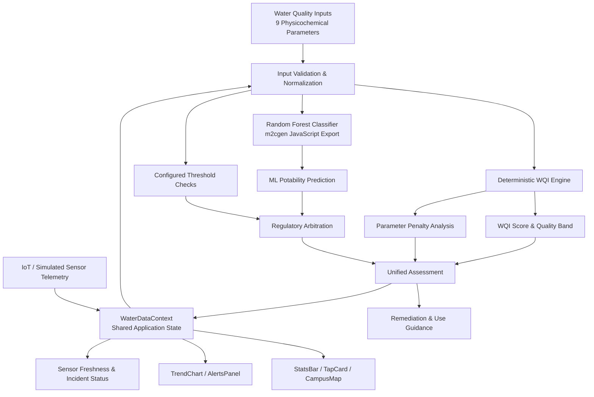
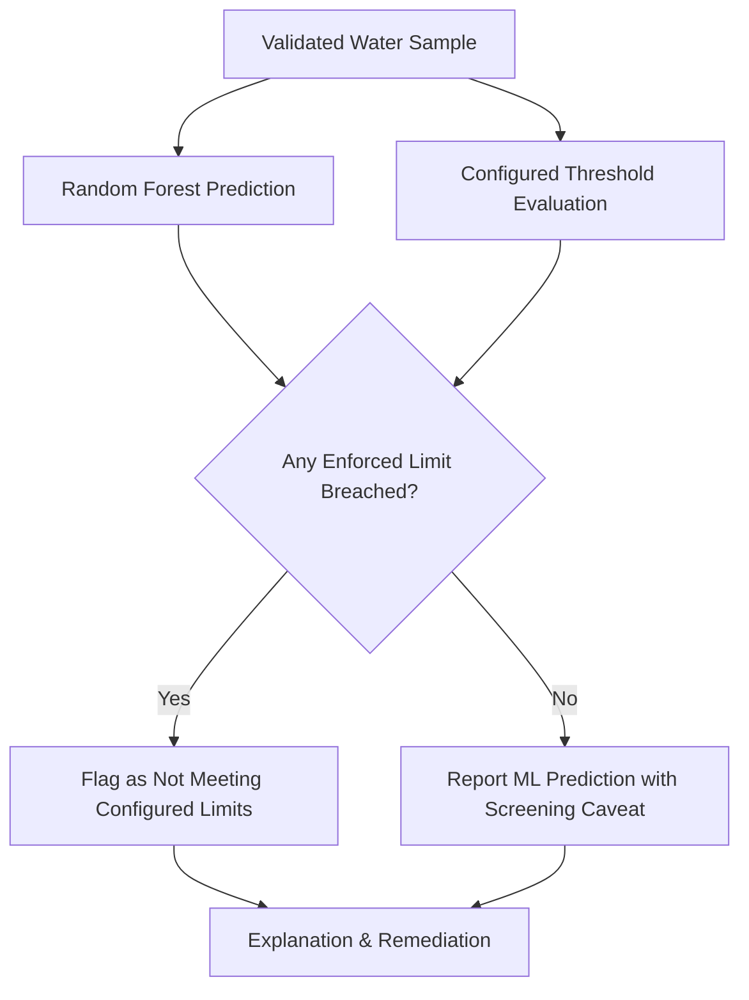

<div align="center">

# 🌊 AquaWatch
### Hybrid AI–Regulatory Water Quality Monitoring & Decision Support
*Explainable water quality scoring • Machine learning potability assessment • Sensor telemetry • Actionable remediation*

</div>

## Overview
AquaWatch is a water-quality monitoring and decision-support application that combines a deterministic, standards-informed evaluation engine with a Random Forest machine learning classifier. It analyzes nine physicochemical measurements, calculates an interpretable Water Quality Index (WQI), identifies influential parameters, checks configured thresholds, and presents results through a responsive monitoring dashboard.

Unlike a purely ML-driven approach, AquaWatch uses regulatory arbitration: an ML prediction cannot override a detected violation of a configured drinking-water limit. This provides an additional safeguard against false assurances from the statistical model.

> **Important:** AquaWatch is a screening and educational decision-support tool, not a certified drinking-water test. Its WQI weights, scoring bands, and some configured thresholds are application-specific; they should not be represented as official BIS/WHO WQI definitions. A sample cannot be certified safe for drinking from these nine parameters alone. Microbiological testing and other applicable chemical tests are also necessary.

## Key Features
- **Nine-parameter analysis:** pH, hardness, total dissolved solids, chloramines, sulfate, conductivity, total organic carbon, trihalomethanes, and turbidity.
- **Deterministic WQI:** Transparent sub-index calculation and weighted aggregation into a 0–100 score.
- **Hybrid inference:** Random Forest classification combined with rule-based threshold checks.
- **Browser-side inference:** Random Forest decision logic exported to dependency-free JavaScript using `m2cgen`; no Python inference server required.
- **Explainable scoring:** Parameter-level penalty scores identify the largest contributors to WQI degradation.
- **Remediation guidance:** Contextual treatment suggestions for elevated contaminants and out-of-range pH.
- **Monitoring dashboard:** Shared sensor state powers summary metrics, station cards, campus map, trend charts, and alerts.
- **Freshness detection:** Readings older than 30 minutes are flagged as stale.
- **Telemetry simulation:** A mean-reverting stochastic generator produces illustrative five-minute sensor readings for demonstrations.
- **Alternative-use insights:** Exploratory recommendations for non-potable uses, subject to use-specific testing and standards.

## System Architecture



### Decision flow
1. Acquire nine water-quality measurements from user input or telemetry.
2. Validate numeric values, units, completeness, and plausible ranges.
3. Calculate parameter sub-indices and the weighted WQI.
4. Predict a potability class using the exported Random Forest model.
5. Check configured limits independently of the ML result.
6. Arbitrate the final screening outcome: a detected threshold breach blocks a positive drinking-water recommendation.
7. Explain the score with weighted penalties and parameter-specific remediation guidance.
8. Display current values, historical trends, alerts, and sensor freshness in the dashboard.

## Water Quality Parameters

The application uses the following configured reference values and weights. These are the values supplied for the current AquaWatch implementation; do not interpret this entire table as a verified transcription of IS 10500:2012. In particular, some parameters and limits are application-specific or may correspond to different chemical species than those named in standards. Verify the precise BIS clauses, analytes, units, and acceptable/permissible definitions before claiming regulatory conformity.

| Parameter | Feature key | Unit | Configured desirable / target | Configured upper / permissible | Weight |
|---|---|---|---|---|---|
| pH | `pH` | — | 7.0 (target) | 6.5–8.5 (range) | 0.15 |
| Hardness | `Hardness` | mg/L | 200 | 600 | 0.10 |
| Total dissolved solids | `Solids` | mg/L | 500 | 2,000 | 0.10 |
| Chloramines | `Chloramines` | mg/L | 4.0 | 4.0 | 0.10 |
| Sulfate | `Sulfate` | mg/L | 200 | 400 | 0.10 |
| Conductivity | `Conductivity` | µS/cm | 400 | 1,000 | 0.10 |
| Total organic carbon | `Organic_carbon` | mg/L | 2.0 | 4.0 | 0.10 |
| Trihalomethanes | `Trihalomethanes` | µg/L | 40 | 100 | 0.10 |
| Turbidity | `Turbidity` | NTU | 1.0 | 5.0 | 0.15 |

**Weight normalization:** $\sum_{i=1}^{9} W_i = 1.00$.

> **Standards caveat:** For example, a chloramine reading is not interchangeable with a free residual chlorine reading; species and measurement definitions matter. Similarly, conductivity and organic carbon thresholds in this application should not automatically be attributed to BIS. BIS/WHO references should be validated against their original documents before production deployment.

## Deterministic WQI Engine
*Implementation:* `src/components/utils/wqiCalculator.ts`

AquaWatch computes a higher-is-better custom WQI from nine normalized sub-indices.

### 1. Lower-is-better sub-index
For parameter value $V_i$, ideal value $V_{io}$, and configured limit $V_s$:
$$q_i = \operatorname{clamp}\left(100 - \frac{V_i - V_{io}}{V_s - V_{io}}\times100,\ 0,\ 100\right)$$
If $V_i \leq V_{io}$, the score is 100. This assumes $V_s>V_{io}$ and appropriate validated units.

### 2. pH sub-index
The current scoring model uses neutral pH 7.0 as its ideal:
$$q_{\mathrm{pH}} = \operatorname{clamp}\left(100 - \frac{|V_{\mathrm{pH}}-7.0|}{1.5}\times100,\ 0,\ 100\right)$$
*Note: The formula is symmetric about pH 7.0, but the configured limits 6.5–8.5 are not. Thus the pH scoring function and regulatory-range check are separate operations. A pH value can be inside the configured range yet receive a low sub-index; the formula should not be described as exactly encoding both limits.*

### 3. Weighted WQI
$$\mathrm{WQI}=\operatorname{round}\left(\frac{\sum_{i=1}^{9}q_iW_i}{\sum_{i=1}^{9}W_i}\right)$$

### 4. Application-defined WQI bands
| WQI | Label | Interpretation |
|---|---|---|
| 90–100 | Excellent | High score on the monitored parameters |
| 70–89 | Good | Generally favorable monitored-parameter profile |
| 50–69 | Fair | Elevated parameters; further evaluation recommended |
| 25–49 | Poor | Significant quality concerns; investigate and treat |
| 0–24 | Very Poor | Severe concerns among monitored parameters |

*These bands describe the application score, not a drinking-water safety certification. Even a WQI of 100 does not establish microbiological safety or the absence of unmeasured contaminants.*

## Machine Learning Classification
*Implementation:* `src/components/utils/generatedModels.ts`

AquaWatch uses a Random Forest Classifier trained on a water-potability benchmark dataset. The trained model is converted into JavaScript decision logic using `m2cgen`, enabling client-side inference without a Python runtime or remote model API.

```ts
export function predictPotabilityML(input: number[]): [number, number];
```

The generated code evaluates learned decision thresholds over the input feature vector. The output is interpreted by the application as an ML prediction; its exact tuple semantics should be documented from the exported implementation before consumers depend on it.

- **Inference advantages:** Local execution, no inference network round trip, straightforward deployment, and deterministic evaluation for a given model and feature vector.
- **Performance note:** Sub-millisecond inference is a project performance target/observation, not a universally guaranteed latency. Record benchmark hardware, browser, number of trials, and percentile latency before publishing a performance claim.
- **Model-validation note:** The source dataset, train/test split, preprocessing, missing-value handling, class balance, precision, recall, F1, ROC-AUC, and calibration results should be added once verified. Predictions from a benchmark dataset do not independently demonstrate field performance or regulatory compliance.

## Regulatory Arbitration & Explainability
*Implementations:*
- `src/config/waterQualityConfig.ts`
- `src/components/utils/mlPredictor.ts`

The final screening outcome combines ML prediction and configured limit checks. If the model predicts a positive potability class but any enforced threshold is violated, the system must not issue a positive drinking-water recommendation.



### Feature contribution
For each parameter:
$$\mathrm{Penalty}_i=(100-q_i)W_i$$
The largest weighted penalty is displayed as the primary WQI score-reduction driver.
*This is an explanation of the deterministic WQI calculation, not a causal attribution or a SHAP/feature-importance explanation of the Random Forest. The two should not be conflated.*

### Example remediation mapping
| Observed issue | Illustrative treatment options |
|---|---|
| Elevated hardness | Lime/soda softening, ion exchange |
| Elevated turbidity | Coagulation/flocculation, sedimentation, filtration |
| Elevated TDS / conductivity | Reverse osmosis, subject to water chemistry |
| Low pH | Calcite contactor or controlled alkalinity adjustment |
| Elevated organics / disinfection by-products | Investigate sources; evaluate precursor removal and treatment process changes |

*Treatment selection requires site-specific testing, process design, and verification. Do not use generic remediation suggestions as proof that treated water is safe to drink.*

## Telemetry & State Management
*Implementations:*
- `src/context/WaterDataContext.tsx`
- `src/components/TrendChart.tsx`

The application uses React Context as a shared source of application state, consumed by `StatsBar`, `TrendChart`, `TapCard`, `CampusMap`, and `AlertsPanel`.

### Freshness detection
$$\mathrm{StationAge}=t_{\mathrm{now}}-t_{\mathrm{lastUpdated}}$$
When $\mathrm{StationAge} > 30\text{ minutes}$, the station is marked `isStale: true`, and the interface presents an offline/stale indication. The supplied architecture also specifies audit-incident generation; verify the persistence mechanism before describing those incidents as durable records.

### Simulated five-minute telemetry
For demonstration and testing, sensor readings follow a mean-reverting stochastic update:
$$V_{t+\Delta t}=\operatorname{clamp}\left(V_t+0.12(V_{\mathrm{base}}-V_t)+\varepsilon_t\right),\qquad \varepsilon_t\sim\mathcal{N}(0,\sigma^2)$$
This creates bounded fluctuations around a baseline. Diurnal variation and additional noise can be layered onto the baseline where implemented. Trend charts use linear segments to avoid visually smoothing away observed or simulated transitions.

> **Simulation disclosure:** Generated readings are synthetic. They are not evidence of deployed hardware, actual ADC sampling, real-time physical measurements, or validated sensor accuracy.

## Technology & Modules

| Layer | Technology / approach |
|---|---|
| Frontend | React, TypeScript, Tailwind CSS, Vite |
| Shared state | React Context (`WaterDataContext`) |
| ML model | Random Forest classifier |
| Model deployment | `m2cgen`-generated JavaScript |
| Scoring engine | TypeScript deterministic WQI calculation |
| Decision safety | Configured threshold checks and arbitration |
| Visualization | Trend charts (Recharts), station cards, campus map (Leaflet / OSM), alerts |
| Data feed | Manual/sample input and simulated sensor telemetry |

### Key source files
```text
src/
├── config/
│   └── waterQualityConfig.ts       # Thresholds and scoring configuration
├── components/
│   ├── utils/
│   │   ├── wqiCalculator.ts        # Deterministic WQI
│   │   ├── mlPredictor.ts          # Prediction and arbitration
│   │   └── generatedModels.ts      # Exported Random Forest logic
│   ├── TrendChart.tsx              # Time-series visualization
│   ├── StatsBar.tsx                # Aggregate monitoring metrics
│   ├── TapCard.tsx                 # Station / tap status
│   ├── CampusMap.tsx               # Spatial monitoring view
│   └── AlertsPanel.tsx             # Alerts and incidents
└── context/
    └── WaterDataContext.tsx        # Shared readings and station state
```

## Getting Started

### Prerequisites
- Node.js (v18 or higher recommended)
- npm or pnpm

### Quick Setup
1. **Clone the repository:**
   ```bash
   git clone https://github.com/Yuvraj-9696-singh/tap-water-wellness.git
   cd tap-water-wellness
   ```
2. **Install dependencies:**
   ```bash
   npm install
   ```
3. **Configure environment variables (optional):**
   ```bash
   cp .env.example .env
   ```
4. **Run development server:**
   ```bash
   npm run dev
   ```
5. **Open local dashboard:**
   Navigate to `http://localhost:8080/` in your browser.

## Testing & Evaluation
Run automated test suites with Vitest:
```bash
npm test
```
Before production use, validate the following:
- **WQI unit tests:** Ideal values, exact thresholds, negative/invalid inputs, missing data, and score clamping.
- **pH boundary tests:** 6.5, 7.0, and 8.5, plus out-of-range cases.
- **Regulatory arbitration:** Positive ML predictions must not override configured-limit violations.
- **Feature integrity:** Correct feature ordering, units, preprocessing, and parity with the original Python model.
- **Model quality:** Held-out evaluation, class imbalance, false-negative rate, calibration, and out-of-distribution behavior.
- **Telemetry:** Freshness cutoff, missing timestamps, clock drift, and simulated reading bounds.
- **UI consistency:** All dashboard views reflect the same shared station state.
- **Field validation:** Compare readings with calibrated instruments and accredited laboratory measurements.

## Limitations
1. The nine features do not cover all drinking-water safety hazards, notably microbial contamination and many trace contaminants.
2. Custom WQI bands and parameter weights are not an official BIS/WHO drinking-water index.
3. Some configured limits require standards review, including chemical-species and unit definitions.
4. The Random Forest's generalization depends on dataset representativeness and measured validation performance.
5. Synthetic telemetry demonstrates UI behavior but does not validate IoT hardware.
6. Irrigation, cooling, and concrete-batching suitability require their own standards and additional parameters; WQI alone is insufficient.

## Future Roadmap
- [ ] Integrate calibrated physical sensors and a documented ingestion protocol.
- [ ] Add secure historical storage, device authentication, and incident audit persistence.
- [ ] Add laboratory-verified microbiological and chemical parameters.
- [ ] Review every threshold against the correct current BIS/WHO reference and analyte definition.
- [ ] Publish reproducible ML training, preprocessing, metrics, and calibration reports.
- [ ] Add confidence/uncertainty indicators and out-of-distribution detection.
- [ ] Add site-level alerting and configurable notification policies.
- [ ] Validate treatment recommendations and alternative-use rules against domain-specific standards.

## Standards & References
- **BIS IS 10500:2012:** Drinking Water — Specification (consult the applicable official version and amendments).
- **WHO Guidelines for Drinking-water Quality:** Risk-based guidance for drinking-water safety.
- **Project benchmark dataset:** Kaggle Water Potability benchmark dataset.
- **m2cgen:** Model-to-code export tooling for generated inference logic.

## Contributors & Acknowledgments
Developed as an Environmental Engineering undergraduate project.

<div align="center">

**AquaWatch — Making water-quality data interpretable, explainable, and actionable.**  
*For research and decision support; not a substitute for certified water testing.*

</div>
